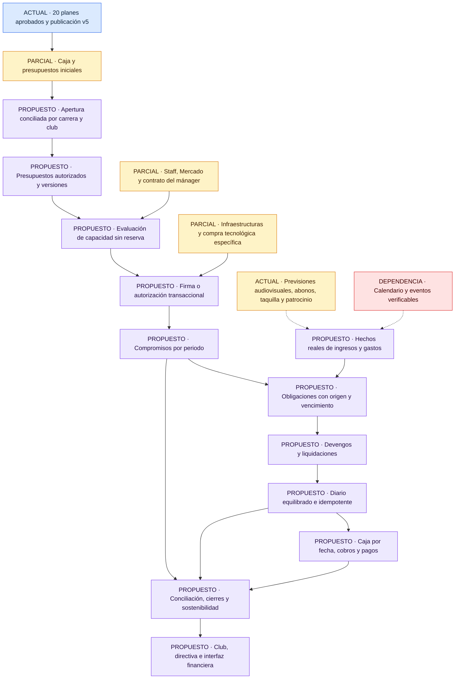
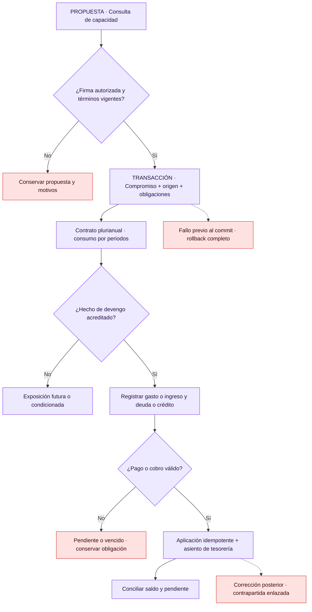

# Diseño de Economía y Finanzas

Propuesta funcional y técnica para revisión, preparada el 18/11/2026 sobre `main`, commit `3c9df44`. Este documento no acredita implementación ni aprueba reglas financieras nuevas. El código y las partidas conservan su estado. Las decisiones de Staff seleccionadas por el usuario se recogen en [Incorporación efectiva de Staff](STAFF_ONBOARDING_DESIGN.md), apartado 10. La auditoría previa se conserva como evidencia histórica en [Auditoría económica](ECONOMY_FINANCE_AUDIT.md).

## 1. Estado real e infraestructura reutilizable

Estado de Git al iniciar la revisión, rama `main`, HEAD `3c9df44`, con `docs/STAFF_ONBOARDING_DESIGN.md` como único archivo pendiente, todavía sin seguimiento. Se contrastaron documentación y código. La clasificación siguiente procede de inspección, sin ejecutar operaciones económicas.

| Componente | Estado actual | Evidencia y límite |
|---|---|---|
| Veinte planes económicos aprobados | Implementado | `EconomicInitialWorld2026.ReadApprovedPlans/LoadOrCreate`, catálogo JSON y publicación v5. Validación de origen por hash, identidad y conservación de jugadores. |
| Recursos económicos por club y temporada | Implementado parcialmente | `Economics001_Initial.sql` guarda plan inmutable, caja, fichajes restante y coste anual del mánager. Dos tablas económicas, sin libro mayor general. |
| Lecturas y compatibilidad | Implementado | `SqliteEconomyStore.ReadResources`, `WorldQueries.GetFinancialResources` y `ClubFinancialResources` devuelven datos ausentes como desconocidos; leer no migra. |
| Presupuestos y previsiones | Modelos parciales con datos aprobados | `ClubEconomicPlan`, `EconomicIncome`, `EconomicExpense` representan límites y previsiones. La masa salarial contractual de jugadores y su margen real permanecen desconocidos. |
| Firma inicial del mánager | Implementado para ese caso | `SqliteCareerStore.Create` y `CommitManager` guardan compromiso anual una vez en la transacción de creación. El coste está incluido en la previsión de personal; no se descuenta caja. |
| Contratos de técnicos de cantera | Implementado parcialmente | `StaffEmployment`, `staff_employments`, `SqliteInitialStaffProfession` guardan salario, moneda, fechas y cláusulas si existe base económica compatible. Falta compromiso financiero general, devengo y pago. |
| Negociaciones de Staff | Implementado hasta acuerdo condicionado | `SqliteStaffOffers` conserva revisiones, estados y aceptación condicionada. Validar el salario frente al plan no acredita disponibilidad agregada para contratar. |
| Mercado y calendarios de pagos | Modelos y negociación parcial | `SqliteTransferStore`, `TransferPaymentPlans` y `TransferFinancialReview` permiten propuestas y comparación informativa de anticipo/caja y fijo/presupuesto. No reservan, consumen ni formalizan por esa comparación. |
| Adquisición tecnológica | Operación específica existente | `SqliteSportsStore.CommitAcquisition` valida una solicitud aprobada y autorización externa, descuenta compra e instalación y registra pedido dentro de una transacción. No hay servicio financiero general ni botón que fabrique autorización. Mantenimiento y operación siguen como datos de la propuesta. |
| Ingresos audiovisuales, abonos, taquilla, patrocinio y comercial | Previsiones | La suma de previsiones no genera contratos, derechos de cobro ni caja. |
| Deuda e intereses | Previsiones y saldos iniciales agregados | Se conocen deuda corta, larga, total e interés previsto. Faltan contratos, acreedores, amortizaciones y cuotas acreditadas. |
| Contabilidad, obligaciones, nómina y liquidaciones comunes | Pendientes | No existen libro mayor general, conciliación completa, cierre financiero, reservas contractuales generales o ejecutor de vencimientos. |
| Interfaz económica | Consulta parcial existente | Ruta `CareerPage.OwnEconomy`, `Main.Navigation` y componentes de economía del club. Mostrar datos no crea sus fuentes operativas. |
| Tiempo y sostenibilidad de varias temporadas | Dependencia pendiente | `CareerWorkspace.CanAdvanceTime` es falso. Sin calendario funcional no existe liquidación diaria automática ni prueba económica real de 30 temporadas. |

Se reutilizarán también `TransferRules.Money`, las políticas monetarias por operación, los validadores de contratos y la creación aislada de carreras. El límite técnico actual de Staff no se aplicará automáticamente a toda la economía. `SqliteEconomyStore.Cents` aporta conversión comprobada a enteros, pero la nueva entrada común deberá validar antes precisión, signo y rango.

### Diferencias relevantes respecto al inventario histórico

La auditoría anterior describía la contratación de otros empleados como bloqueada. Hoy existen contratos profesionales iniciales y negociación persistente. Sigue faltando incorporación efectiva. También existe un descuento específico de caja para tecnología. Ese caso debe incorporarse al diseño de movimientos comunes; no permite declarar implementados nómina, obligaciones o contabilidad.

La caja actual está almacenada por club y temporada, y varias operaciones consultan por club esperando una fila. El nuevo diseño debe separar caja continua de presupuestos estacionales. Añadir temporadas sin adaptar esas consultas podría duplicar saldos, actualizar varias filas o fallar en una selección única. La inicialización financiera deberá resolverlo antes del rollover.

## 2. Criterios seleccionados y propuestas pendientes

Los criterios de Staff P1, P2, P4, P5, P7 y P9 están seleccionados para el diseño. P3 y P8 tienen aprobación parcial y límites expresos. P6 acuerda distinguir conceptos; coste empresarial, nómina, vencimientos, solvencia y condiciones siguen pendientes de concreción.

En particular, la negociación consulta capacidad sin inmovilizar presupuesto. La firma vuelve a validarla transaccionalmente y genera compromisos. Registrar compensación no extingue deudas o contratos. Cada compensación identifica causa, acreedor, obligación y efecto contractual. El alta futura depende del calendario funcional.

El resto de las políticas de este documento se propone para revisión. Se propone un núcleo contable pequeño, con diario equilibrado, documentos de origen, obligaciones y aplicaciones de pago. Su utilidad es conciliar caja, deuda y resultado y recuperar errores; el jugador puede utilizar una presentación simplificada.

## 3. Conceptos y ciclos económicos

| Concepto | Significado propuesto | Ejemplo de origen |
|---|---|---|
| Previsto | Estimación versionada, sin derecho ni deuda por sí sola | Previsión audiovisual del plan inicial. |
| Autorizado | Límite aprobado por un actor competente para una partida y periodo | Presupuesto anual de Staff. |
| Comprometido | Parte del límite afectada por contratos u operaciones formalizadas | Remuneración contractual por periodos. |
| Obligación o derecho de cobro | Pago o cobro identificado, con causa, contraparte y vencimiento o condición | Cuota de una compra o factura de patrocinio. |
| Devengado | Ingreso o gasto reconocido por un hecho acreditado y su periodo | Servicio prestado o nómina de periodo verificado. |
| Pagado o cobrado | Aplicación efectiva de dinero a una obligación o derecho | Transferencia de una cuota vencida. |
| Tesorería | Dinero efectivo en cuentas del club, por moneda y fecha | Saldo de apertura más entradas menos salidas. |

Un compromiso puede existir antes del devengo. Una obligación puede estar pactada antes de reconocer un gasto. Un anticipo puede pagarse antes del devengo y quedar como activo hasta recibir el servicio. La contabilidad y el presupuesto deben conservar estas diferencias.

El ciclo propuesto es previsión, autorización, formalización y compromiso, generación de obligaciones por origen, reconocimiento del hecho y liquidación. El orden temporal entre devengo y pago depende del contrato. Una consulta, borrador, envío o contraoferta no produce movimientos económicos.

### 3.1 Alcance, monedas e importes

Cada registro pertenece a una carrera y a un club o a una relación entre clubes de esa misma carrera. Usar moneda explícita y unidades menores enteras para cantidades persistidas. En el alcance inicial EUR admite dos decimales. Los cálculos intermedios usarán precisión decimal y una política versionada de redondeo. En un reparto cerrado, el último vencimiento absorbe el residuo para que la suma coincida exactamente.

Las obligaciones y pagos tienen importe positivo; anulaciones y reversiones se representan con operaciones enlazadas. Las cuentas pueden tener saldos deudores o acreedores según su naturaleza. Los presupuestos pueden presentar disponible negativo como desviación informativa, pero una autorización nueva deberá someterse a la política aprobada. El saldo de caja vigente no admite negativo y se propone conservar ese criterio hasta diseñar financiación o descubierto autorizado.

No mezclar monedas en sumas ni convertir por la nacionalidad de una persona. Los veinte clubes tienen EUR según el catálogo. Otras monedas exigirán configuración y política explícita de cambio. Límites técnicos de importes, sumas y conversiones se comprobarán antes de escribir; nunca truncar o redondear silenciosamente la entrada del usuario.

## 4. Tesorería y conciliación

Se propone una cuenta de tesorería por club y moneda como mínimo. Varias cuentas bancarias solo cuando exista una necesidad del juego. La caja será continua entre temporadas. El periodo presupuestario y el ejercicio contable se vinculan al movimiento sin crear otra caja inicial al cambiar de temporada.

El saldo en una fecha será saldo de apertura conciliado más cobros efectivos menos pagos efectivos hasta esa fecha. Las operaciones pendientes figurarán en la agenda y en la previsión de liquidez, sin incrementar o reducir el efectivo. Una operación confirmada actualiza diario, aplicaciones, obligación y proyección de caja en la misma transacción.

Cada movimiento tendrá ID permanente, carrera, club, cuenta, moneda, fecha efectiva de carrera, secuencia estable, origen, actor o evento y operación idempotente. Distinguir la fecha del hecho de su fecha de registro. El tiempo real del ordenador puede servir como metadato de diagnóstico, pero no determinar vencimientos, saldos deportivos ni devengos.

La conciliación compara el diario de tesorería con el saldo materializado y las aplicaciones de cobros y pagos con el pendiente de cada documento. Un saldo materializado es una proyección comprobable. Una discrepancia bloquea nuevas escrituras del ámbito afectado hasta revisión; no se corrige sumando o restando una cantidad sin causa.

Los ajustes exigen documento, motivo y autoridad. Después del commit se corrige por contrapartida enlazada; antes del commit se aplica rollback. No borrar movimientos para cuadrar saldos. Las cuentas y documentos de clubes de origen y destino en el mismo archivo se registrarán juntos cuando una operación requiera ambos lados.

## 5. Presupuestos adaptados a cada club

Se propone una estructura de partidas por club, con vigencia, procedencia y jerarquía. El presupuesto general agrega partidas existentes. Hijos y padres no se suman dos veces. Etiquetas como Cantera, equipo y departamento permiten analizar un gasto desde varias vistas, pero cada imputación tiene una única partida primaria o un reparto cuyos porcentajes suman 100 %.

| Partida contemplada | Base disponible | Propuesta de desarrollo |
|---|---|---|
| General | Previsiones globales | Agregación de partidas autorizadas y revisiones de directiva. |
| Fichajes | TransferBudget y TransferRemaining | Consumo por operación formalizada según una política presupuestaria explícita. |
| Salarios de jugadores | Límite y gasto previsto | Compromiso individual cuando exista contrato salarial acreditado. Margen contractual desconocido mientras falte. |
| Salarios de Staff | StaffBudget, previsión de personal y contratos parciales | Conciliar contrato inicial del mánager y de técnicos con el plan antes de añadir nuevos compromisos. |
| Cantera | YouthBudget y equipos existentes | Delimitar qué costes incluye. No duplicar nómina de técnicos ya imputada a Staff. |
| Instalaciones e inversión | Adquisición tecnológica específica y datos de estadio | Partidas aprobadas solo para proyectos o activos documentados. |
| Operaciones y mantenimiento | Previsiones de operaciones y estadio | Compromisos y gastos respaldados por servicios o hechos reales del juego. |
| Otros departamentos | Información según club | Abrir partidas cuando haya estructura y fuente acreditadas. No generar personal ni gasto para cubrir huecos. |

Cada partida mostrará previsto, autorizado, comprometido pendiente, ejecutado y disponible, con periodo, moneda, base de medición y estado de información. Una revisión presupuestaria conserva actor, motivo, fecha y valores anteriores. Un traspaso entre partidas requiere autorización y mantiene el total si no se aprueba una ampliación.

### 5.1 Evitar doble consumo

Se propone que el presupuesto económico se consuma por ejecución reconocida y por compromiso aún pendiente de ejecutar. Para una partida y periodo con esa política, disponible = autorizado − ejecutado neto − compromiso pendiente. Cuando se reconoce una parte ya comprometida, se reduce el compromiso pendiente y aumenta ejecutado por el mismo importe. El pago posterior no vuelve a consumir esa partida.

Para compras de jugadores o inversiones puede requerirse una base de autorización distinta de su gasto contable, por ejemplo el importe fijo de la operación. Cada partida llevará una política versionada de base de consumo. Mostrar esa base y evitar comparar consumo de inversión con gasto de amortización. La elección concreta de base para fichajes, instalaciones y costes empresariales queda pendiente de aprobación.

Si falta parte de los compromisos o su coste, el disponible contractual se presenta como incompleto o desconocido. Puede mostrarse el límite y la exposición conocida, evitando autorizar una firma apoyada en un margen ficticio. Las negociaciones de Staff no crean reservas previas.

### 5.2 Compromisos plurianuales

Registrar el compromiso completo del contrato y distribuirlo en los periodos a los que afecta, conservando importe contractual, política de asignación y versión. Antes de autorizar, consultar capacidad actual y exposición futura. Las autorizaciones de temporadas aún sin presupuesto aprobado necesitan una política explícita de compromisos futuros, separada de la aprobación del presupuesto anual.

La firma no exige mantener en caja toda la nómina de varios años. Se propone comprobar pagos inmediatos, obligaciones próximas y capacidad presupuestaria por periodo; horizonte, cobertura y tratamiento de incertidumbre deben aprobarse. Las previsiones futuras son escenarios etiquetados, sin convertirse en cobros garantizados.

## 6. Fuentes de ingresos y gastos

| Fuente de ingreso | Hecho o documento mínimo | Devengo y cobro propuestos |
|---|---|---|
| Derechos audiovisuales | Contrato o reparto aprobado con condiciones verificables | Reconocimiento según derecho generado y periodo de prestación; cobro por vencimientos contractuales. El reparto de previsión no produce caja. |
| Patrocinios y acuerdos comerciales | Contrato, vigencia, prestaciones y contraparte | Devengo por prestación o hitos verificados; facturas y cobros separados. |
| Abonados | Ventas acreditadas y cobertura de temporada o eventos | Cobro anticipado como ingreso diferido hasta reconocer el servicio según política aprobada. La cifra de abonados desconocida no genera ventas. |
| Taquilla | Partido o evento real, aforo y ventas verificables | Reconocer el derecho y cobro correspondientes al hecho. Sin calendario y evento no hay recaudación automática. |
| Premios deportivos | Resultado, regla de competición y hecho de concesión | Reconocer cuando se acredita el derecho y programar cobro conforme al concedente. |
| Venta de futbolistas | Formalización válida, precio y condiciones verificadas | Derecho de cobro y efecto de la baja del activo cuando corresponda a la política aprobada; cobros por cuotas. |
| Actividades comerciales | Venta o servicio documentado | Importe y costes acreditados por operación. Evitar sumar otra vez previsiones de patrocinio o merchandising incluidas en el agregado comercial. |
| Otros ingresos | Causa, actor y evidencia del hecho | Requiere tipo aprobado y tratamiento definido. El alta de un ajuste no inventa un negocio. |

| Tipo de gasto o inversión | Origen requerido | Tratamiento propuesto |
|---|---|---|
| Salarios de jugadores y Staff | Contrato y servicio del periodo | Compromiso, nómina devengada y deuda; pago posterior. Coste empresarial separado del salario bruto. |
| Primas y cláusulas | Condición pactada y evento activador | Exposición condicionada hasta poder evaluar el hecho. Registrar una sola vez al cumplirse. |
| Compensaciones e indemnizaciones | Causa, acreedor y efecto contractual | Obligación propia enlazada a salida, sustitución u otro acto autorizado. No cancela por asociación otras deudas. |
| Fichajes | Formalización y costes reconocidos | Separar desembolso, inversión y gasto contable. Política de capitalización y amortización por aprobar. |
| Mantenimiento y servicios | Contrato, prestación o factura acreditada | Gasto y obligación por periodo o hito. Pagos anticipados como tales. |
| Instalaciones | Proyecto autorizado, contrato y recepción de hitos | Anticipos, obra en curso y activo cuando proceda. Mantenimiento y explotación permanecen diferenciados de compra e instalación. |
| Cantera y formación | Equipos, empleados, cursos o servicios existentes | Imputación a partida y ámbito adecuados; sin inventar promociones, cursos completados o nuevos técnicos. |
| Intereses y deuda | Contrato financiero y calendario acreditado | Interés como gasto de periodo; devolución de principal reduce deuda. Recibir un préstamo aumenta caja y deuda, no ingreso operativo. |

No se proponen tasas fiscales ni cifras legales nuevas. Retenciones, cotizaciones, impuestos, estructura de pagas y referencias laborales necesitan política y fuentes verificadas cuando se concrete su implementación. Los factores ya congelados del plan inicial mantienen su procedencia y no se presentan como cálculo legal universal.

## 7. Compromisos, obligaciones y derechos de cobro

Cada compromiso conserva contrato u operación origen, revisión aceptada, club, periodos, partidas, moneda, cantidades firmes y exposición condicionada. El compromiso presupuestario y la obligación no se suman como dos costes distintos en la misma consulta.

Cada obligación o derecho tendrá ID permanente, carrera, origen tipado y su revisión, acreedor, deudor, concepto, moneda, importe pactado, fecha de registro, fecha de exigibilidad o condición pendiente, estado, documentos de devengo, aplicaciones y trazabilidad. Un vencimiento desconocido debe figurar como desconocido. Una condición aún no verificable conserva exposición, sin crear una deuda exigible ficticia.

| Estado propuesto | Criterio |
|---|---|
| Condicionada | Depende de un hecho real todavía no acreditado; importe o fecha pueden quedar pendientes si así lo permite el contrato. |
| Programada | Importe y vencimiento firmes; puede estar antes de devengo. |
| Exigible | Alcanzado el vencimiento y cumplidas las condiciones. |
| Parcialmente liquidada | Aplicaciones confirmadas por una parte del importe exigible. |
| Liquidada | Aplicaciones netas igualan importe vigente de la obligación. |
| Vencida pendiente | Fecha de exigibilidad transcurrida y saldo pendiente. Se deriva por fecha, sin duplicar deuda. |
| Rectificada o cancelada por documento | Cambio autorizado enlazado. Mantiene la secuencia original y el efecto real sobre deuda, compromisos y contabilidad. |

Se propone separar estado de condición, vencimiento y liquidación en la representación técnica para evitar combinaciones ambiguas. La tabla es una vista comprensible para el jugador, no un enum definitivo.

El pendiente será importe vigente − aplicaciones netas válidas. No permitir sobrepago salvo procedimiento de anticipo explícito. Un pago puede aplicarse a varios documentos y una obligación admitir pagos parciales; cada aplicación tiene ID e importe y la suma debe coincidir con el movimiento. Los abonos y devoluciones referencian aplicaciones anteriores. La compensación entre deudas necesita acuerdo explícito y no altera caja si no hay dinero.

Los pagos aplazados de Mercado se convierten en obligaciones al formalizar, con una fecha de formalización real y conservación de las propuestas anteriores. El calendario relativo propuesto puede reutilizarse, pero la fecha estimada de un borrador no acredita un vencimiento ejecutable. Cualquier cambio material exige aceptación de las partes afectadas.

## 8. Contabilidad mínima y trazabilidad

### 8.1 Núcleo necesario

Se propone diario de partida doble por club, moneda y operación, con cuentas reducidas de tesorería, cuentas a cobrar/pagar, anticipos, activos/inversiones, deuda, ingresos, gastos y apertura/resultados. Cada asiento tiene al menos dos líneas, suma de débitos igual a créditos y vínculo al documento o hecho real. El catálogo puede ser interno y versionado; no exige reproducir un plan contable legal completo.

Este núcleo permite responder cuánto dinero hay, qué se debe, qué se ha ganado o gastado y por qué. Eliminar el equilibrio obligaría a reconstruir esas relaciones de forma dispersa. La interfaz mostrará conceptos económicos, partidas, vencimientos y origen; débitos, créditos y códigos de cuentas quedarán en el detalle de auditoría cuando ayuden a revisar una discrepancia.

### 8.2 Ejemplos de interpretación propuesta

| Hecho | Débito | Crédito | Efecto de caja |
|---|---|---|---|
| Servicio salarial devengado y pendiente | Gasto de personal | Nómina a pagar | Ninguno. |
| Pago de nómina ya devengada | Nómina a pagar | Tesorería | Salida efectiva. |
| Derecho de patrocinio acreditado | Cuenta a cobrar | Ingreso por patrocinio | Ninguno. |
| Cobro de ese derecho | Tesorería | Cuenta a cobrar | Entrada efectiva. |
| Anticipo de abonos de temporada | Tesorería | Ingreso diferido | Entrada; el ingreso se reconoce al prestar el servicio. |
| Préstamo recibido | Tesorería | Deuda financiera | Entrada; no aumenta resultado operativo. |
| Principal de préstamo devuelto | Deuda financiera | Tesorería | Salida; no es gasto de interés. |
| Inversión recibida a crédito | Activo u obra en curso | Proveedor a pagar | Ninguno hasta pagar. |

Las cifras se omiten para no atribuir importes nuevos al mundo. Amortización de jugadores, depreciación de instalaciones, fiscalidad, deterioros e imputación de costes accesorios requieren reglas concretas para su entrega. La tesorería y las obligaciones pueden empezar antes, pero una pantalla de resultado contable completo necesitará esas políticas.

### 8.3 Apertura y periodos

La apertura de una carrera compatible se basará en el saldo actual conservado, no en volver a aplicar InitialCash. Registrar fecha de corte, hash/procedencia del estado y una contrapartida técnica de apertura. Esa contrapartida se identifica como saldo inicial no desglosado; no se atribuye a capital, beneficios históricos o ingresos inventados. El alcance contable inicial se mostrará como parcial hasta acreditar patrimonio y restantes cuentas.

Importar deuda agregada conocida una sola vez como saldo de apertura, conservando que acreedor y calendario no están desglosados. No convertirla en cuotas ficticias ni estimar intereses desde una tasa inventada. Los contratos y obligaciones ya acreditados se importan según su causa, con conciliación para evitar duplicar esos saldos. Reconocer un saldo no exige declarar pagado un documento.

Se propone periodo contable y presupuestario explícitos. El cierre comprueba equilibrio, conciliación, obligaciones, incidencias e integridad y guarda un resumen reproducible. Una corrección de un periodo cerrado se registra en el periodo abierto con referencia al original, salvo reapertura autorizada definida. El cierre anual incorpora los saldos de balance al siguiente periodo, sin reiniciar caja o deuda ni volver a generar compromisos de contratos plurianuales.

## 9. Capacidad y sostenibilidad

| Indicador propuesto | Cálculo y significado | Límites de interpretación |
|---|---|---|
| Caja efectiva | Apertura conciliada + cobros − pagos a la fecha | Disponible monetario actual, distinto de presupuesto. |
| Obligaciones próximas | Pendiente firme exigible hasta fecha de horizonte H | H debe configurarse y mostrarse. No incluye contingencias como deuda firme. |
| Proyección de liquidez | Caja + cobros firmes previstos − pagos firmes previstos hasta H | Separar cobros documentados de estimaciones inciertas y mostrar cobertura de datos. |
| Cobertura de vencimientos | Recursos líquidos documentados hasta H / obligaciones firmes hasta H | Si denominador es cero, mostrar sin vencimientos. No infinito ni solvencia garantizada. |
| Capacidad salarial | Autorización salarial − ejecución − compromiso salarial pendiente en la misma base y periodo | Si faltan salarios o coste empresarial, el margen real queda incompleto. |
| Exposición futura | Compromisos por periodo y condiciones todavía abiertas, separados | No suma como deuda vencida ni demanda toda su caja hoy. |
| Endeudamiento | Principal pendiente conocido, por acreedor y plazo cuando consten | Endeudamiento neto = deuda financiera − caja comparable, con alcance explícito. |
| Coste del servicio de deuda | Principal e intereses contractuales que vencen en H | La previsión agregada sin calendario no basta para calcularlo exactamente. |
| Resultado de periodo | Ingresos devengados − gastos reconocidos en la misma política | Mostrar parcial si falta amortización u otro bloque necesario. |
| Flujo operativo | Cobros operativos − pagos operativos del periodo | Diferenciar financiación e inversión. |
| Peso salarial sobre ingresos | Coste salarial reconocido / ingreso operativo reconocido del periodo | Denominador cero o negativo se presenta como no comparable. Sin umbral de color inventado. |

Los indicadores muestran magnitudes, horizonte, políticas y calidad de información. Los umbrales de riesgo, autorización o alerta deben aprobarse con significado y pruebas de referencia; este diseño no introduce un semáforo de insolvencia arbitrario. La autorización de una contratación o inversión consulta capacidad y obligaciones bajo transacción. Una previsión favorable no autoriza por sí sola financiación inexistente.

## 10. Arquitectura técnica y servicios comunes propuestos

Core mantendrá entidades y validadores económicos independientes de SQLite y Godot. Persistence aplicará transacciones y lecturas por carrera. Godot consultará proyecciones y enviará comandos con versión esperada y operación estable. Se reutilizan los proyectos actuales, sin proponer otro sistema de almacenamiento.

### 10.1 Entidades conceptuales

| Entidad propuesta | Identidad y relaciones |
|---|---|
| Contexto financiero | Carrera, club, moneda, fecha de corte, versión y estado de inicialización. |
| Partida y revisión presupuestaria | Club, periodo, jerarquía, base de consumo, autorizado, actor y motivo. |
| Compromiso y asignación a periodos | Origen, revisión, cantidades firmes/condicionadas, partida y distribución temporal. |
| Obligación o derecho | Acreedor, deudor, origen, concepto, importe, moneda, vencimiento/condición y documentos asociados. |
| Hecho de devengo | Origen verificable, periodo, importe y regla versionada. |
| Asiento y líneas | Documento, fecha, cuentas, importes, contrapartida y rectificación si existe. |
| Movimiento y aplicación | Tesorería, contraparte, importe, fecha y obligaciones que liquida. |
| Operación idempotente | ID de solicitud, tipo, huella, versión esperada, origen y resultado confirmado. |
| Periodo y cierre | Fechas, estado, sumas de control, fecha de corte y referencias a incidencias. |

Los nombres y tablas definitivos quedan para la implementación. Ninguna de estas entidades conceptuales crea saldos en esta tarea.

### 10.2 Contratos de servicios

| Servicio propuesto | Entradas y resultado | Garantía |
|---|---|---|
| Consulta financiera | Carrera, club, fecha, periodo y moneda → saldos, presupuesto, exposición y cobertura de datos | Lectura sin migración ni escritura. |
| Evaluación de capacidad | Operación propuesta, costes por periodo, obligaciones inmediatas y ámbito autorizado → apta, no apta o pendiente, con motivos | Sin reserva de negociación. Devuelve versión y política de la evaluación. |
| Autorización/revisión de presupuesto | Partidas, cambios, periodo, actor y versión → revisión aprobada | Control de autoridad, reparto sin duplicar y trazabilidad. |
| Formalización financiera | Operación, documento origen, revisión, costes, fecha, versiones y autorización → compromisos y obligaciones | Revalidación transaccional e idempotencia junto a la operación deportiva o laboral. |
| Registro de devengo | Hecho real, periodo, regla y origen → documento contable y pendiente asociado | Un hecho se reconoce una sola vez. |
| Liquidación | Obligaciones, aplicaciones, caja, actor/evento y fecha → pago/cobro y asiento | Sin sobrepago, moneda coherente, control concurrente de saldo y compromiso. |
| Rectificación | Operación original, causa, autorización y efecto → documento vinculado | Conserva historial; evita borrar cargos ya confirmados. |
| Conciliación/cierre | Ámbito y fecha de corte → comprobaciones, incidencias y cierre | Estado reproducible sin reinicializar patrimonio. |
| Agenda económica | Fecha de carrera y eventos vencidos → operaciones ordenadas y resultados | Procesamiento recuperable, sin inventar devengos o cobros. |

La evaluación previa es informativa; la firma no puede confiar en ella si cambiaron datos. Los módulos deberán usar el servicio común de formalización dentro de una unidad de trabajo de Persistence. Los servicios públicos actuales que abren conexiones propias no garantizan atomicidad si se llaman consecutivamente; se propondrán puntos internos que compartan conexión y transacción cuando se implemente.

### 10.3 Persistencia futura e idempotencia

Proponer grupos de registros para contexto y apertura; presupuestos y revisiones; compromisos por periodo; obligaciones y condiciones; documentos y líneas; movimientos y aplicaciones; operaciones idempotentes; periodos y cierres. Claves con carrera/club/origen, FK y revisiones optimistas. Los importes persistidos se almacenarán como enteros comprobados. El enlace tipado a contratos o acuerdos validará pertenencia a la carrera incluso si el origen usa JSON.

Cada comando externo tendrá ID estable y huella de términos. Igual ID e igual huella devuelve el resultado confirmado. Igual ID con otros términos devuelve conflicto. Añadir unicidad de negocio por origen, concepto y periodo o vencimiento evita duplicaciones enviadas con otro ID. Las liquidaciones parciales necesitan identificador de pago y aplicación, no solo un indicador pagado por contrato.

### 10.4 Escritura atómica y recuperación

1. Abrir transacción de escritura del archivo de carrera y buscar el resultado idempotente.
2. Releer fecha, actor, origen, revisiones, presupuesto, compromisos, obligación y caja. Validar pertenencia y política monetaria.
3. Comprobar capacidad o saldo bajo el bloqueo y registrar toda la operación. Una firma de Staff incluye contrato, compromisos y ocupación; un traspaso incluye sus cambios de plantilla cuando ese módulo esté autorizado.
4. Registrar asientos equilibrados y aplicaciones pertinentes, actualizar proyecciones y guardar resultado. Verificar restricciones antes de commit.
5. Tras el commit, refrescar consultas. Una futura notificación debe derivarse de un evento persistido para que se pueda repetir sin duplicar el hecho.

Una excepción previa al commit revierte también presupuesto, obligación y saldo. Si la aplicación pierde la respuesta tras commit, el reintento recupera el resultado. Los fallos de bloqueo/conflicto requieren relectura acotada. Una operación entre clubes del mismo archivo confirma ambos lados o ninguno. Si el acreedor está fuera del mundo simulado, se conserva contraparte externa y documento, sin inventar su contabilidad.

Después del commit, la reversión es un acto nuevo enlazado con autoridad y causa. Un pago rechazado por insuficiencia conserva la obligación pendiente y el contrato firmado. No usar cancelación silenciosa como recuperación de errores.

### 10.5 Reloj de carrera

Las operaciones automáticas dependen de calendario funcional. Guardar claves por origen, fecha efectiva y secuencia. Al avanzar varios días, procesar hechos por fecha, fase del evento y ID estable. Respetar la causalidad, por ejemplo devengar un servicio antes de liquidar su nómina y activar un puesto antes de autorizar actividades de ese día. Un bucle reanudado consulta el resultado de cada evento.

La fecha de pago efectiva registra cuándo pudo liquidarse; el vencimiento original permanece. La mora se deriva de ese vencimiento. El cierre de periodo se ejecuta tras los hechos del periodo y sus validaciones. La política final de fases del día se aprobará junto al calendario; el reloj actual bloqueado impide presentar esta automatización como disponible.

## 11. Integración con los módulos existentes

| Módulo | Hecho que aporta | Servicio común y dependencia |
|---|---|---|
| Staff | Revisión aceptada, contrato, fecha efectiva, salida y sustitución | Evaluar, formalizar, devengar nómina y liquidar. Alta/baja y finanzas comparten transacción. Pendientes coste empresarial y calendario. |
| Mercado | Acuerdo entre clubes, condiciones personales y formalización | Convertir precio y cuotas en compromisos/obligaciones, generar derechos del vendedor y pagos. Empezar por traspaso simple al contado según hoja de ruta. |
| Cantera | Equipos, personal, formación y servicios acreditados | Etiquetar costes y ámbito sin duplicar nóminas de Staff. Contratación usa flujo común y gasto real requiere hecho. |
| Entrenamiento | Sesiones, responsables, servicios externos e instalaciones utilizados | Un entrenamiento guardado no produce pago o progreso económico. Consumos o servicios con coste requieren contrato/política y evidencia de ejecución. |
| Club y directiva | Autoridad, presupuesto y cambios aprobados | Revisar partidas y límites con actor competente. Los permisos de negociación o delegación existentes no conceden autoridad financiera general por sí solos. |
| Infraestructuras | Proyecto, propuesta, autorización, hito recibido y contrato | Comprometer inversión, registrar anticipos, recepciones, pagos y mantenimiento. Concursos de arquitectura futuros podrán aportar propuestas y adjudicación, sin asumir que ya existen. |
| Competiciones y comercial | Resultado, ventas, patrocinio o derechos | Acreditar ingresos y vencimientos. Sin sus hechos, mantener la previsión. |

Las configuraciones Directa/Delegada de Cantera y las modalidades de Entrenamiento se mantienen como fuentes deportivas. El módulo económico no genera empleados para ejercer autorizaciones. Cada club usa su organigrama documentado.

Antes de permitir movimientos comunes junto a `CommitAcquisition`, deberá adaptarse o conciliarse esa ruta particular para que no escriba caja por fuera del diario. El compromiso inicial del mánager tendrá un identificador de importación y una única fuente operativa. No se sumará otra vez al gasto previsto del plan.

## 12. Compatibilidad e inicialización

Las publicaciones versionadas son origen inmutable. Las carreras reciben su estado financiero independiente. Consultar partidas antiguas permanece de solo lectura, sin poblar tablas ni crear contratos.

La futura migración será versionada, transaccional, con respaldo de la carrera y validación de integridad. Las carreras con economía importarán sus saldos actuales y documentos acreditados a fecha de corte. Las adquisiciones ya registradas se concilian contra el saldo actual, sin descontarlas otra vez ni atribuirles una fecha histórica inexistente. Conservar la trazabilidad conocida y etiquetar el detalle anterior no reconstruible.

Las carreras sin extensión económica necesitan una política de inicialización aprobada y documentada. No aplicar automáticamente los veinte planes a una fecha avanzada como si fueran sus saldos actuales. Podrán seguir consultándose con información desconocida hasta resolver su apertura. Contratos, ofertas, jugadores, técnicos, IDs y publicaciones permanecen preservados.

Las previsiones agregadas y contratos iniciales se reconciliarán antes de calcular capacidad salarial real. Cuando falten salarios de jugadores o desgloses de deuda, declarar cobertura parcial y bloquear únicamente las autorizaciones cuya comprobación dependa del dato ausente. Esto exige políticas de capacidad por operación, no una aprobación financiera genérica.

## 13. Propuesta de navegación

Dentro de Club, ampliar la ruta existente Economía con un área Economía y Finanzas, evitando un segundo panel de caja independiente. La navegación conceptual propone los siguientes apartados.

| Pantalla propuesta | Información y decisión que facilita |
|---|---|
| Resumen | Caja, disponible por partida, obligaciones próximas y cobertura de datos. Entradas a incidencias y documentación de origen. |
| Tesorería | Movimientos por fecha y cuenta, cobros/pagos pendientes y saldo conciliado. |
| Presupuestos | Previsto, autorizado, comprometido pendiente, ejecutado y disponible por periodo y ámbito; revisiones autorizadas. |
| Ingresos y gastos | Devengado y cobrado/pagado con columnas diferenciadas y comparación con previsión. |
| Contratos y obligaciones | Contrato u operación origen, contraparte, vencimientos, condición, pendiente y aplicaciones. |
| Situación financiera | Proyección de liquidez, deuda y exposición futura con fórmulas y horizonte accesibles. |
| Historial de operaciones | Firma, origen, actor, rectificación y resultado idempotente. Detalle contable bajo demanda. |

Reutilizar tablas, filtros, recursos centralizados y selección por ID de Godot. Tema oscuro y acentos naranjas, valores monetarios españoles y cifras alineadas a la derecha. Mantener filtros de periodo/club al navegar. Mostrar desconocido, pendiente, previsto y real explícitamente. Cada importe enlaza al documento que lo explica. Colores siempre acompañados de texto y cantidad.

Solo habilitar acciones cuyos servicios y permisos existan. La revisión visual futura cubrirá 1280×720, 1600×900 y 1920×1080 con listas largas y cifras grandes. Esta tarea no añade pantallas ni controles.

## 14. Hoja de ruta y primera entrega recomendada

Se conserva F1–F6 del nuevo encargo como propuesta de secuencia. Es una revisión para este diseño de la numeración de la auditoría histórica. Cada fase se divide para que la validación no quede aplazada hasta F6. Los adaptadores de integración se definen desde el principio; las operaciones se activan cuando sus dependencias estén completas.

| Fase | Entrega pequeña propuesta | Dependencias y aceptación |
|---|---|---|
| F1a | Apertura conciliada, contexto financiero y diario mínimo | Política de apertura aprobada. Saldo actual exacto, origen documentado, operaciones equilibradas y ninguna duplicación de saldos. |
| F1b | Partidas, revisiones y compromisos por periodo | F1a y base de consumo aprobada. Importar mánager y Staff conocido sin duplicar, separar margen desconocido de cero y validar concurrencia. |
| F2a | Obligaciones, condiciones y derechos de cobro | F1, conceptos y vencimientos definidos. Un origen produce una obligación o calendario único, con aplicaciones verificables. |
| F2b | Liquidaciones, devengos básicos y rectificaciones | F2a. Pago/cobro atómico, conciliación, idempotencia y fallo recuperable. Activar eventos automáticos solo con reloj funcional. |
| F3 | Fuentes operativas por eventos | F2 y contratos/hechos del módulo origen. Empezar por una fuente acreditada; previsiones conservadas hasta disponer de hechos. |
| F4 | Presupuesto anual, deuda y sostenibilidad | F1/F2 y periodos/calendario. No reiniciar caja al renovar presupuesto; principal/interés y riesgo con reglas aprobadas. |
| F5a | Adaptador contractual de Staff y traspaso simple | F1/F2, política de capacidad y costes aprobada, y modelos laborales/deportivos preparados. Firma y efectos atómicos; no requiere todas las fuentes de F3 ni financiación avanzada de F4. |
| F5b | Resto de condiciones contractuales | F5a y aprobación específica de cada regla. Plazos, cláusulas, cesiones y agentes según alcance y dependencias verificadas. |
| F6 | Interfaz, compatibilidad y validación integrada | Cada entrega añade su cobertura; al integrar, verificar navegación, permisos, migraciones y comportamiento completo. |

La primera entrega recomendada para revisión es **F1a**. Su alcance es apertura financiera por carrera/club/moneda, saldo de corte conciliado, diario mínimo, consulta por fecha e identificación idempotente de la apertura. Dejaría preparado el contrato de capacidad y presupuestos de F1b sin habilitar contratación.

F1a debe probar dos carreras independientes, apertura repetida sin duplicar, saldo actual exacto, información histórica ausente conservada, fallo con rollback y lectura sin escritura. El diseño de cómo registrar una operación equilibrada debe quedar comprobado con documentos aislados de prueba. No requiere producir nuevos ingresos, pagar nóminas, recalcular jugadores ni hacer funcionar el reloj.

Antes de programar F1a se necesita aprobar su contrapartida técnica de apertura y cómo conciliar saldos existentes, incluida la ruta tecnológica. F1b necesita aprobar bases presupuestarias; F2 exige definiciones de devengo y vencimiento. La contratación real de Staff permanece bloqueada por estas dependencias y el modelo de puestos; describir las interfaces no las satisface.

## 15. Criterios de aceptación y pruebas futuras

| Área | Comprobaciones necesarias |
|---|---|
| Apertura | Plan inicial inmutable, saldo de carrera actual preservado, importación repetida sin duplicar y deuda sin calendario ficticio. |
| Identidad | Aislamiento por carrera, club y moneda; referencias a contratos y revisiones correctas; acreedor/deudor acreditados. |
| Importes | Precisión, sumas y conversiones comprobadas, céntimos extremos, reparto con residuo y rechazo sin truncamiento. |
| Presupuestos | Distintas estructuras de clubes, revisiones, transferencias autorizadas y ausencia de doble suma por jerarquía o etiquetas. |
| Compromisos | Distribución plurianual, paso de pendiente a ejecutado sin doble consumo, cancelación autorizada e incertidumbre visible. |
| Contabilidad | Cada asiento equilibrado, anticipos separados, deuda principal e intereses diferenciados y proyecciones conciliadas. |
| Obligaciones | Vencimientos válidos, parciales, condición no evaluable, activación una vez, abono y rectificación trazables. |
| Pago y cobro | Aplicación exacta, ausencia de sobrepago, insuficiencia de caja conservando la deuda, y operación entre clubes atómica. |
| Concurrencia | Dos operaciones sobre la misma caja o presupuesto no superan capacidad. Una revisión obsoleta exige relectura. |
| Idempotencia | Mismo ID/huella devuelve mismo resultado; ID con otros términos falla; otro ID para el mismo hecho no duplica. |
| Fallos | Inyectar error en cada escritura, cerrar antes/después de commit y recuperar tras reapertura sin estado parcial. |
| Tiempo | Fecha de carrera, vencimiento preservado si se paga tarde, saltos de días y cierres recuperables. Reloj real no interviene. |
| Compatibilidad | Carreras con/sin economía, contratos Staff, adquisiciones previas y datos parciales; hashes de publicaciones inmutables y FK correctas. |
| Regresión | Staff, Mercado, Cantera, Entrenamiento e Infraestructuras conservan contratos, jugadores, tácticas y planes. |
| Interfaz | Valores con estado y origen, tablas largas, permisos y ausencia de recortes en tres resoluciones. |
| Largo plazo | Tras existir reloj y eventos reales, simular 30 temporadas, conciliar saldos y medir deuda, costes, distribución de recursos y viabilidad según umbrales aprobados. |

La implementación ejecutará pruebas unitarias de Core, integración SQLite y recorridos Godot apropiados a cada entrega, además de suite completa Debug/Release para cierre. Las pruebas con documentos de ejemplo serán copias aisladas y no hechos del mundo comercial. Esta revisión documental no ejecuta una nueva suite. La última evidencia comunicada del código permanece en 852 superadas, 0 fallidas y 0 omitidas.

## 16. Decisiones financieras para aprobación

| ID | Decisión propuesta | Consecuencia de dejarla pendiente |
|---|---|---|
| EF1 | Diario equilibrado mínimo y catálogo interno reducido | No fijar esquema definitivo ni resultados contables completos. |
| EF2 | Apertura por saldo actual con contrapartida técnica y datos incompletos explícitos | F1a requiere esta aprobación para evitar historia financiera inventada. |
| EF3 | Caja continua por club/moneda, periodos separados y sin descubierto implícito | Adaptación futura del almacenamiento estacional y compra tecnológica pendiente. |
| EF4 | Base de consumo por partida, fórmula de disponible y tratamiento plurianual | F1b y autorizaciones reales requieren límites y políticas por periodo. |
| EF5 | Coste empresarial, prorrateo, calendario de nómina y vencimientos de primas/compensación | No formalizar contratos reales que necesiten esos cálculos. Mantener cifras pactadas existentes. |
| EF6 | Condiciones financieras, exposición contingente y pruebas de cumplimiento | No ejecutar cláusulas sin hechos y reglas aprobados. |
| EF7 | Horizonte de liquidez, cobertura y criterio de autorización frente a incertidumbre | Mostrar magnitudes; no aprobar por semáforos o ratios arbitrarios. |
| EF8 | Ingresos diferidos, inversiones, amortización y depreciación | Resultado contable incompleto hasta concretar esas políticas. |
| EF9 | Cierre de periodos, reapertura y rectificación posterior | Requiere política antes de activar operaciones retroactivas. |
| EF10 | Apertura compatible de carreras sin economía o con detalle histórico parcial | Mantener lectura y datos desconocidos; no inicializar retrospectivamente sin criterio aprobado. |
| EF11 | Autoridad de directiva, permisos y límites por operación | No inferir poder financiero de una delegación deportiva. |

Se propone aplazar reservas preparatorias previas a firma conforme a P5. Fiscalidad detallada, bancos múltiples, financiación compleja, mercado bursátil, concursos de arquitectura, automatización de nóminas sin calendario y valoración contable completa de jugadores serían prematuros en F1. Forman posibles extensiones sujetas al contrato de alcance de Furvo y a encargos posteriores.

## 17. Riesgos y dependencias críticas

El principal riesgo es permitir escrituras simultáneas por el modelo nuevo y los campos de caja anteriores. La transición deberá establecer una única fuente financiera y reconciliar adaptadores. El segundo es interpretar previsiones como deudas o ingresos reales; cada proyección tendrá estado y evidencia. El tercero es autorizar gasto con obligaciones salariales incompletas; las respuestas de capacidad deben preservar la incertidumbre.

Staff necesita identidad laboral, historial de puestos y firma separada de alta. Mercado necesita formalización deportiva, condiciones personales y contrato salarial. Cantera y Entrenamiento aportan estructuras y actividades, sin sustituir esos contratos. Infraestructuras necesita proyectos, autorizaciones y recepciones verificables. El calendario es dependencia de ejecución temporal. Los datos y reglas de cada fuente son condición previa a generar obligaciones de esa fuente.

El diseño no considera aprobadas todas estas propuestas. La programación deberá comenzar por una entrega delimitada y autorizada después de revisar EF1–EF3 y la apertura existente.

## 18. Fuentes y mapa editable

Se revisaron `STAFF_ONBOARDING_DESIGN.md`, `ECONOMY_FINANCE_AUDIT.md`, `STAFF_ARCHITECTURE.md`, `STAFF_HIRING.md`, los diseños de Delegaciones y Entrenamiento, el contrato V1.0 y la arquitectura histórica. Se contrastaron los modelos económicos de Core, servicios y esquema económicos de Persistence, negociación Staff/Mercado, adquisición tecnológica, navegación de carrera y pruebas `EconomicCareerTests` y `NavigationFinanceQueryTests`.

Pizarra nueva creada con tldraw en [Arquitectura de Economía y Finanzas](https://www.tldraw.com/f/y3jpS_EyDzucEAegVELUg). Distingue ACTUAL, PARCIAL, PROPUESTO y DEPENDENCIA mediante texto y color. Contiene el mapa de componentes y un segundo flujo de operación para el caso habitual con devengo anterior al pago. Los anticipos siguen el tratamiento específico del apartado 8 y no requieren un devengo previo de gasto o ingreso. La pizarra de incorporación de Staff se conserva sin cambios. Las estructuras reproducibles se incluyen debajo.

## 19. Diagramas reproducibles

