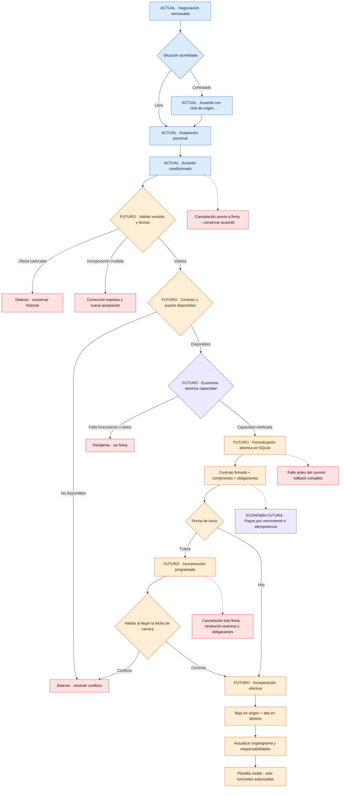

# Diseño de incorporación efectiva de Staff

Diseño revisado sobre `main`, commit `3c9df44`, el 18/11/2026. P1, P2, P4, P5, P7 y P9 son criterios seleccionados para el diseño. P3 y P8 tienen aprobación parcial de diseño. P6 distingue los conceptos económicos, con sus reglas pendientes de concreción financiera. El apartado 10 delimita estas decisiones. Los estados concretos, interfaces, estructuras de almacenamiento y reglas adicionales siguen siendo propuestas. La selección del diseño no autoriza su implementación.

La infraestructura financiera común se desarrolla conceptualmente en [Economía y Finanzas](ECONOMY_FINANCE_DESIGN.md). No se fija todavía una migración SQL.

## 1. Base aprobada y alcance

El encargo establece identidad permanente del empleado, conservación de contratos e historial, comprobación del puesto y sus competencias, validación económica antes de formalizar y coherencia transaccional. Cada club debe conservar su organigrama documentado, con equipos y departamentos propios. Se mantienen atributos profesionales 1–20, reputación 1–5, fortalezas, debilidades e idiomas. La contratación autoriza las funciones del puesto acordado y las responsabilidades expresamente asignadas.

La fecha de referencia es la de la carrera. El vencimiento es inclusivo. Un inicio el 18/11/2026 y tres años termina el 17/11/2029. Las ofertas caducadas y las revisiones históricas permanecen consultables. Cambiar términos requiere una revisión explícita. El acuerdo con el club de origen y la aceptación personal son pasos diferenciados.

Este diseño abarca los puestos existentes de entrenador de cantera. El catálogo de especialidades de Core admite categorías futuras, pero su existencia como definición no acredita puestos, empleados ni autorizaciones en un club. El contrato del mánager del usuario mantiene su modelo y flujo propios.

## 2. Funcionamiento contrastado con el código

| Componente existente | Comportamiento comprobado por inspección | Reutilización y límite |
|---|---|---|
| `StaffOffer`, `StaffOfferTerms`, `StaffOfferRules` | Fases Club y Personal. Estados Draft, Sent, Counter, ClubAgreed, Conditional, Rejected, Withdrawn y Expired. Importes y cláusulas estructurados. | Mantener negociación y validación monetaria. Conditional conserva una aceptación personal condicionada. Falta el expediente de firma y alta. |
| `SqliteStaffOffers` | Guarda revisiones con control optimista, verifica carrera, club y fecha, y limita negociaciones activas por candidato para el comprador. | Reutilizar identidad y revisión del acuerdo. La exclusividad laboral global del empleado requiere una comprobación adicional al firmar. |
| `StaffOfferRules.ValidateIncorporation` y `LastContractDay` | Rechazo de incorporación pasada y cálculo inclusivo para 1, 2, 3 y 5 años. | Reutilizar en la firma. La activación de un contrato futuro requiere reglas específicas del ciclo firmado. |
| `StaffProfile.ContractStatus` | Acredita libre con `ConfirmedFree` o vencimiento conocido. Un contrato futuro devuelve Unknown antes de su inicio. | Ampliar la proyección con contratos actuales, futuros y terminaciones efectivas. Un vínculo futuro debe impedir otra firma incompatible. |
| `StaffProfession`, `StaffEmployment` | Perfil profesional, historial opcional de etapas, salario anual, fechas y cláusulas. Las altas iniciales mantienen la identidad institucional. | Reutilizar validadores y valores guardados. La trayectoria del perfil admite etapas terminadas, con final hasta la fecha de carrera. No sirve por sí sola como registro de puestos abiertos. |
| `staff_professions`, `staff_employments` | Perfil ligado por FK a `academy_staff`. `staff_employments.employee_id` es UNIQUE y conserva un único documento contractual. | Hace falta historial de contratos y una identidad que sobreviva a cambios de equipo o club. |
| `academy_staff`, `SqliteAcademyStore.Read` | `team_id` es obligatorio y UNIQUE. La lectura hace JOIN con el técnico institucional y devuelve un único Coach. | La vacante necesita representación explícita. Eliminar o trasladar la fila actual puede hacer desaparecer el equipo de algunas consultas y romper FK de perfiles u ofertas. |
| `SqliteStaffDirectory.Read` | Club derivado del equipo institucional. Valida el club del contrato contra ese club. Solo lista técnicos con `link_state='Institutional'` y cargo HeadCoach, además del mánager. | Adaptar la proyección a destinos, libres e historial. Cambiar únicamente el club del contrato produciría incoherencia con el directorio. |
| `SqliteSportsStore.Staff` y `SaveDelegation` | Proyectan el mánager y el técnico institucional del equipo, con competencias por tarea; guardan delegación y revisión del plan. | Reutilizar tareas y modalidades, añadiendo disponibilidad laboral efectiva y autorización del ámbito. |
| `AcademyTeamState.EffectiveManagement`, `SetManagement` | La gestión efectiva depende de Institutional. La táctica propia o sincronizada conserva configuración independiente. | Sustituir la fuente de disponibilidad por la asignación laboral vigente, conservando ambos ajustes y las tácticas. |
| `TrainingRules`, `TrainingStaffEffect`, `TrainingProfiles`, `SqliteTrainingExecutionStore` | Validación de responsables, conflictos horarios y asistencia. Los perfiles conocidos fuera de vigencia se excluyen del efecto profesional. La evidencia guarda responsable y versión. | Reutilizar validaciones y evidencias. La vigencia contractual del efecto y la autorización efectiva de gestión deben consultar la misma disponibilidad. |
| `SqliteEconomyStore.ReadResources`, `CommitManager` | Planes, caja y presupuesto inicial; compromiso inicial exclusivo del mánager. | Los planes proporcionan referencia, no saldo salarial comprometido general. CommitManager no es un servicio de contratación de Staff. |
| `CareerWorkspace.CanAdvanceTime` | Sigue siendo falso. | La incorporación futura depende de un servicio real de avance temporal. |

Las reglas actuales comprueban caducidad al mover la oferta. La fase personal conserva la compensación acordada; las respuestas son deterministas y permiten hasta tres contraofertas por fase. La fórmula de compensación vigente es una estimación de Furvo. Este diseño conserva el importe acordado y exige volver a aceptar cualquier modificación.

La auditoría financiera describe carencias estructurales y contiene inventarios históricos. El código actual ya tiene contratos profesionales y `SqliteSportsStore.CommitAcquisition` descuenta caja para una adquisición tecnológica específica. Ese flujo particular no proporciona nómina, obligaciones, reservas ni libro mayor reutilizable para Staff. Esta excepción se distingue de la ausencia de infraestructura financiera general.

## 3. Modelo funcional propuesto

P1 selecciona un expediente independiente de incorporación, enlazado a una revisión exacta del acuerdo. Negociación, firma y alta efectiva son procesos diferenciados. Se propone conservar los estados actuales de negociación para mantener la interpretación de los enums y ofertas antiguas. Los estados del expediente de la tabla siguiente requieren revisión de detalle.

| Estado propuesto del expediente | Significado y salida |
|---|---|
| En preparación | Se consulta el acuerdo Conditional y se comprueban las condiciones de firma. |
| Pendiente de resolver | Incidencia de disponibilidad, puesto, financiación o datos. Registra motivos; permite volver a comprobar. |
| Firmado y programado | Contrato y compromisos firmes registrados, inicio futuro, puesto reservado para su intervalo. El empleado mantiene sus funciones de origen hasta su baja efectiva. |
| Incorporado | Vínculo y puesto de destino efectivos. Baja de origen y responsabilidades tratadas. |
| Cancelado antes de firma | Se conserva el acuerdo y el motivo. El diseño inicial no inmoviliza presupuesto en la negociación. |
| Resolución posterior a firma | Procedimiento expreso sobre contrato y obligaciones. Conserva firma y trazabilidad; puede requerir indemnización. |

Las incidencias de activación se registrarán como incidencias de un expediente firmado, sin convertirlo en un borrador ni cancelar sus obligaciones automáticamente. La firma y la fecha de efecto son hechos distintos. Una oferta posterior nunca cambia el contrato firmado.

### 3.1 Flujo hasta la firma

1. Cargar la carrera desde su archivo y comprobar autoridad del actor, identidad del empleado, ID del acuerdo y última revisión. Si la operación ya terminó, devolver su resultado persistido.
2. Exigir aceptación personal Conditional sobre los términos de firma. Para un empleado contratado, comprobar además el acuerdo de origen aplicable, el contrato afectado y las condiciones exactas de liberación. Para un libre, exigir disponibilidad acreditada; un dato desconocido requiere resolución.
3. Comprobar que la oferta sigue vigente y que incorporación y finalización son válidas. La firma en la fecha Expires se admite conforme al criterio actual; al día siguiente, se bloquea. La caducidad de la oferta limita la firma, y no cancela un contrato futuro ya firmado.
4. Resolver el puesto documentado de destino, ámbito, intervalo disponible, competencias y permisos de contratación. Determinar si se ocupa una vacante o si hay una sustitución explícita autorizada.
5. Comprobar todos los vínculos actuales y futuros del candidato y la compatibilidad de intervalos, puestos y carga. La consulta cubre todos los clubes de esa carrera, incluidos los de origen y destino.
6. Construir el documento de costes con salario, prima, compensación acordada, cláusulas y obligaciones de salida o sustitución. Obtener autorización financiera vigente y verificable.
7. Presentar los términos finales y los efectos de una sustitución. Si cambia salario, fecha, compensación, puesto o cláusulas respecto a lo aceptado, exigir la revisión y las aceptaciones afectadas antes de continuar.
8. Formalizar en la transacción descrita en el apartado 6. Para un inicio de hoy, firma y activación forman parte de esa misma operación. Para un inicio futuro, registrar contrato, reserva temporal del puesto y obligaciones, manteniendo la activación pendiente del calendario.

P4 exige nueva revisión y aceptación de las partes afectadas ante cambios materiales de salario, fechas, compensación, puesto, liberación o cláusulas. El acuerdo de origen debe enlazarse a la revisión que lo acredita. La matriz concreta que determina las partes afectadas por cada cambio sigue propuesta para revisión. Los cambios de compensación o liberación afectan al club de origen y los de condiciones personales al empleado; cuando afecten ambos bloques se propone renovar ambas aceptaciones.

### 3.2 Casos de destino

| Caso | Propuesta de tratamiento |
|---|---|
| Libre, vacante, inicio hoy | Validar libertad y puesto, firmar y activar de forma atómica. |
| Contratado, vacante, inicio hoy | Exigir acuerdo de salida; cerrar efectivamente el vínculo incompatible de origen y activar el destino en la misma transacción. |
| Incorporación futura | Firmar ahora solo con disponibilidad futura acreditada, puesto reservado y compromisos económicos. Mantener empleado y actividades en origen hasta el día pactado. |
| Sustitución | Identificar al ocupante, causa y fecha de salida, consentimiento o autoridad y coste resuelto. La firma del nuevo empleado no extingue por sí misma el contrato del ocupante. |
| Candidato o puesto deja de estar disponible antes de firma | Rechazar la operación con motivo concreto, sin firma parcial. Permitir corregir o cancelar expresamente. |
| Puesto o vínculo incompatible cambia tras firma | Registrar incidencia; resolver explícitamente. Impedir una segunda ocupación incompatible. Mantener las obligaciones del contrato firmado hasta un acto válido de resolución. |
| Fecha de incorporación transcurrida antes de firma | Exigir nueva revisión y las aceptaciones afectadas. Evitar desplazar fechas automáticamente. |
| Carrera salta varias fechas con contrato firmado | El futuro reloj debe procesar el evento con su fecha efectiva pactada y orden estable, antes de actividades posteriores. No aplicar la validación de borrador contra la fecha final del salto. |

### 3.3 Baja de origen y alta de destino

Se propone registrar la terminación efectiva del vínculo anterior mediante un evento enlazado a su contrato, conservando íntegro el documento original. Para una incorporación el día D, el último día efectivo del vínculo incompatible anterior será D−1. El precio acordado de salida y la liquidación de obligaciones anteriores permanecen separados. Un contrato que ya terminó necesita únicamente su cierre acreditado.

P2 adopta identidad profesional permanente e independiente de club, equipo y contrato, con historiales propios de contratos y ocupaciones. El alta conserva ID, perfil, atributos, idiomas y experiencia. Se propone crear un ID nuevo de contrato y asignación al puesto, con club y equipo de destino, fecha efectiva y origen del movimiento. La trayectoria presenta etapas acreditadas sin inventar años de experiencia ni progresión por firmar. Una persona libre conserva identidad aunque carezca de equipo.

La baja libera el puesto de origen desde su fecha efectiva y termina las autorizaciones incompatibles. El nuevo empleado aparece en la plantilla efectiva del destino al activarse. Antes de esa fecha puede figurar como incorporación programada, distinguida del personal disponible. El expediente debe conservar el resultado de cada intento y su motivo.

## 4. Organigramas, puestos y responsabilidades

Se propone un catálogo versionado por club con procedencia, estado de verificación, departamentos, puestos, ámbito club/equipo, competencias y capacidad de ocupación. Se reutilizarán los equipos e identificadores de `AcademyCatalog` y su documentación de investigación. La existencia de un equipo permite reconocer el puesto ya modelado de su entrenador institucional; no acredita otros departamentos.

Un puesto tendrá identidad estable y periodos de ocupación. Se distinguirán puesto existente vacante, ocupado, reservado para un intervalo e información pendiente. Una laguna documental conserva su estado pendiente. La contratación requiere un puesto acreditado dentro del alcance del club. La capacidad y las incompatibilidades se definen por puesto, evitando crear automáticamente puestos idénticos para los veinte clubes.

P3 admite parcialmente varios puestos compatibles en un mismo club y exige bloquear inicialmente contratos laborales simultáneos incompatibles entre clubes. Los límites de carga, horarios y capacidad deben definirse antes de activar esa mecánica. Se propone separar contrato y asignaciones para permitir un contrato con varios puestos compatibles. La matriz de incompatibilidades, sus excepciones y los límites cuantitativos siguen pendientes; no se deducen de los atributos ni autorizan organigramas uniformes.

### 4.1 Responsabilidades al salir

| Registro afectado | Tratamiento propuesto en la fecha efectiva |
|---|---|
| Delegación de Entrenamiento | Finalizar autorización del empleado en el ámbito de origen y registrar motivo. Control efectivo personal del mánager si sigue autorizado; en otro caso, tarea pendiente de responsable. |
| Gestión Directa/Delegada de cantera | Conservar modalidad solicitada e historial. Resolver control efectivo con el ocupante vigente y sus permisos. Una vacante vuelve al control personal autorizado. |
| Sesiones y grupos futuros con responsable explícito | Conservar contenido deportivo; marcar necesidad de revisión de responsable. Cambiar responsable únicamente mediante política aprobada o decisión expresa. |
| Sesión pendiente de ejecución con empleado ya fuera | Bloquear su ejecución bajo ese responsable. Permitir reasignación autorizada antes de procesarla. |
| Asistencia, sesiones ejecutadas e informes emitidos | Conservar autor, fecha, modelo y contribución histórica del empleado. La baja no recalcula resultados anteriores. |
| Actividad iniciada que atraviese la fecha de baja | Resolver antes de activar el traslado, o segmentar mediante una regla temporal aprobada. La granularidad actual por día exige una política explícita; no atribuirla al sustituto. |
| Táctica, tres planes, seis disposiciones y alineaciones | Conservar configuración y jugadores. La baja laboral afecta a la autorización de gestión. |

P9 determina que la baja finaliza autorizaciones incompatibles, permite retorno al mánager autorizado y preserva entrenamientos, informes y actuaciones históricas. El diseño propone persistir motivo y fecha de ese retorno. Una reasignación posterior del antiguo empleado al club no reactivaría automáticamente sus antiguas delegaciones; esa regla de reactivación sigue propuesta de detalle.

### 4.2 Responsabilidades al entrar

P9 establece que el empleado entrante no hereda automáticamente las delegaciones del predecesor. Ocupar el puesto habilitará sus funciones institucionales documentadas y la delegación operativa requerirá asignación expresa por tarea y ámbito, consultando disponibilidad. La futura plantilla mostrará competencias y responsabilidades efectivamente asignadas. Cualquier política adicional de tareas ligadas al puesto requiere aprobación.

## 5. Contrato requerido a Economía y Finanzas

Los nombres siguientes describen interfaces propuestas en Core y operaciones de Persistence. No existen hoy como servicios de contratación. Deben compartir la transacción SQLite de la carrera mediante un coordinador interno de Persistence. Core recibe documentos y resultados, sin depender de SQLite ni de Godot.

| Operación propuesta | Entrada mínima | Resultado y garantías requeridas |
|---|---|---|
| Evaluar capacidad | Carrera, club, moneda, fecha, versión del presupuesto, costes y contrato/puesto objetivo | Aprobado, rechazado o datos pendientes, con motivos y desglose. Lectura sin reserva ni pago. |
| Reserva preparatoria, aplazada por P5 | Requiere necesidad demostrada y aprobación específica | Queda fuera del diseño inicial de negociación. |
| Comprometer contratación | ID de operación y contrato, versiones esperadas y plan de obligaciones | Revalida capacidad dentro de la transacción y registra compromiso una sola vez. |
| Registrar obligaciones | Acreedor, deudor, contrato o acuerdo de origen, concepto, importe, moneda, fecha y condición | ID único por obligación. Distingue firme, condicionada, vencida, pagada y anulada mediante eventos. |
| Liquidar vencimientos | Fecha de carrera, obligación y clave de aplicación | Cargo y abono/asientos correspondientes exactamente una vez, con importe pendiente y evidencia de liquidación. |
| Rectificar contrato | Operación original, autorización y motivo | Obligación firmada rectificada mediante documento vinculado y contrapartida cuando proceda. |
| Consultar disponibilidad | Fecha y periodos, presupuestos, compromisos y saldo conciliado | Separación de previsto, autorizado, comprometido, pendiente y pagado. Las reservas preparatorias quedan aplazadas. |

### 5.1 Conceptos económicos

| Concepto | Información requerida antes de firma | Momento y criterio propuestos |
|---|---|---|
| Salario bruto anual | Importe y moneda aceptados, intervalo inclusivo y coste empresarial configurado | Compromiso por periodos contractuales. Nómina futura según política de devengo y calendario que deberá aprobar Economía. |
| Prima de fichaje | Importe aceptado, beneficiario y vencimiento explícito | Registrar obligación al firmar si es firme. Pago en su fecha pactada. Un vencimiento desconocido requiere definición. |
| Compensación de origen | Importe y moneda del acuerdo, club acreedor, condición de liberación y vencimiento | Obligación separada del salario. La estimación existente no constituye por sí sola una aceptación de cobro. |
| Indemnización de salida o sustitución | Causa, contrato afectado, condición y cantidad exigible o regla aprobada | Condicionada mientras no exista hecho activador. Registrar obligación firme solo cuando corresponda. |
| Aumentos, reducciones y primas por objetivo | Cláusula, condición verificable, versión de regla y tratamiento presupuestario aprobado | Conservar condiciones y exposición. No activarlas sin eventos deportivos reales y reglas de cálculo aprobadas. |
| Salarios y obligaciones del club anterior | Fecha efectiva de baja y documentos ya devengados o pagados | Mantener deuda previa del origen. Evitar facturar días posteriores a una baja válida o pagar dos veces un mismo concepto. |

P7 exige que cada compensación identifique causa, acreedor, obligación y efecto contractual. Su registro no extingue automáticamente deudas ni contratos. La compensación al club y el salario restante del empleado pueden tener fundamentos diferentes. Se propone un acuerdo de liquidación que determine las obligaciones que sustituye o extingue y el acto que produce ese efecto. La sustitución del ocupante puede añadir un coste distinto del traslado del candidato.

P6 separa conceptualmente presupuesto autorizado, compromiso contractual, obligación, devengo, pago y tesorería. La concreción de coste empresarial, nóminas, vencimientos, solvencia y obligaciones condicionadas queda pendiente del diseño financiero. Se propone descontar los compromisos presupuestarios por periodo y comprobar cobertura de pagos inmediatos según política explícita, sin exigir toda la nómina plurianual en efectivo al firmar. El horizonte y los límites necesitan aprobación.

Las previsiones iniciales de personal ya contienen costes de plantilla. Economía debe conciliar contratos iniciales y coste del mánager con esas previsiones al abrir el registro de compromisos, evitando sumar dos veces la misma masa salarial. Un valor desconocido se devuelve como pendiente, sin convertirlo en cero. Monedas diferentes requieren una política expresa; no efectuar conversiones implícitas.

### 5.2 Reservas, obligaciones y pagos

P5 selecciona consultar capacidad sin inmovilizar presupuesto durante la negociación, revalidarla transaccionalmente al firmar y generar compromisos económicos con el contrato firmado. Las reservas preparatorias previas a firma quedan aplazadas salvo necesidad demostrada. El compromiso futuro consumirá capacidad presupuestaria según la política de periodos pendiente de concreción; no constituye una reserva de negociación.

Los pagos posteriores pertenecen al servicio financiero. Si un pago falla tras una firma ya confirmada, conservar contrato y deuda y registrar la incidencia. Cualquier condición que haga imprescindible un pago para liberar al empleado debe estar expresamente pactada y satisfecha antes del alta. Economía necesitará poder registrar esa liquidación y la activación en la misma transacción cuando la regla lo exija. La cancelación de un contrato firmado no equivale a rollback técnico.

## 6. Persistencia, integridad y transacciones propuestas

### Componentes técnicos propuestos

| Componente nuevo propuesto | Responsabilidad y límite |
|---|---|
| Servicio de disponibilidad laboral en Core | Evaluar intervalos, vínculos, competencias, puestos y carga usando instantáneas de la carrera. |
| Servicio de organigrama y ocupaciones en Core | Validar puesto, vacante, reserva temporal, sustitución y procedencia de su definición. |
| Coordinador de incorporación en Persistence | Ejecutar firma, baja, alta, compromisos y cambios de autorización bajo una misma unidad de trabajo. |
| Resolución común de responsabilidades | Proporcionar a Entrenamiento y Cantera la persona autorizada en fecha y ámbito, junto al motivo de retorno al control personal. |
| Proyección laboral de lectura | Adaptar el directorio y las fichas existentes a identidad, contratos, ocupaciones, historial e incorporaciones programadas. |
| Procesador de incorporaciones por fecha | Consumir eventos del futuro calendario y activar contratos firmados una sola vez, antes de las actividades de ese día. |

La presentación futura enviará comandos con revisión e ID de operación y mostrará los motivos devueltos. Las reglas de firma y las decisiones financieras permanecerán en los servicios de dominio y persistencia.

### 6.1 Necesidades futuras de datos

| Concepto futuro | Datos y restricciones esenciales |
|---|---|
| Identidad profesional permanente | ID existente, datos personales y perfil versionado. Independiente de una fila de ocupación. Mantener referencias históricas de ofertas y actividades. |
| Catálogo de puestos | ID, club, equipo opcional, departamento y rol existentes, procedencia, capacidad, vigencia y versión. |
| Contratos laborales | ID propio, empleado, club, documento firmado inmutable, fechas originales, cláusulas, revisión del acuerdo y versión. Permitir historial y contratos futuros compatibles. |
| Ocupaciones de puesto | Empleado, puesto, contrato, periodo efectivo, estado y revisión. Capacidad e intervalos compatibles comprobados en escritura. |
| Terminaciones y movimientos | Contrato origen/destino, fecha efectiva, motivo, acuerdo de salida y actor. La terminación efectiva complementa el texto original. |
| Expedientes de incorporación | ID de operación, acuerdo y revisión, huella de términos, contrato resultante, estado, fecha prevista/efectiva, incidencias y resultado idempotente. |
| Asignaciones y eventos de responsabilidad | Ámbito, tarea, empleado, fechas, modalidad solicitada, control efectivo, motivo de cambio y revisión. |
| Finanzas | Presupuestos, compromisos, obligaciones, aplicaciones de pago y rectificaciones, enlazados a contrato y operación. Las reservas preparatorias quedan aplazadas por P5. |
| Agenda de incorporaciones | Contrato, fecha efectiva y estado de procesamiento. Orden estable y clave única de activación. |

Los nombres definitivos y el SQL se definirán en la implementación aprobada. Hoy `staff_employments` solo admite un contrato por empleado y las FK dependen de `academy_staff`. La migración futura debe liberar esa dependencia sin cambiar los ID ni perder las referencias. Una vista o adaptador de compatibilidad puede mantener proyecciones antiguas durante la transición, pero las escrituras nuevas deben usar una única fuente laboral.

### 6.2 Unidad de trabajo de firma

Se propone un único coordinador de contratación en Persistence con conexión y transacción compartidas. Los servicios públicos existentes que abren su propia conexión aportan reglas reutilizables, pero no pueden encadenarse como sustituto de una unidad atómica.

1. Iniciar una transacción de escritura y comprobar pertenencia a la carrera. Consultar la clave idempotente antes de rechazar un reintento ya completado.
2. Si la clave ya existe con la misma huella, devolver el contrato y resultado anteriores. Si corresponde a otros términos, devolver conflicto. Una restricción adicional sobre acuerdo y revisión impide duplicarlo usando otra clave.
3. Releer última revisión del acuerdo, caducidad, aceptaciones, disponibilidad, versiones de contratos y puesto, competencia del actor y fecha de carrera. Releer las delegaciones afectadas y recursos financieros.
4. Validar intervalos laborales y capacidad del puesto. El bloqueo de escritura y las comprobaciones de solapamiento serializan dos firmas rivales para un mismo empleado o vacante. Usar FK y unicidad para las identidades; la compatibilidad temporal requiere validación específica.
5. Registrar contrato firmado, compromiso, obligaciones y reserva del puesto. Registrar liberación futura del origen o, si el inicio es hoy, terminación efectiva, baja, alta y cambios necesarios de responsabilidades.
6. Guardar resultado idempotente y trazabilidad de firma; confirmar una sola vez. Cerrar la transacción antes de refrescar Godot o notificar a la bandeja futura.

Cualquier fallo previo al commit revierte todas las escrituras, incluidos compromisos y cambios de responsables. Los fallos de bloqueo o conflicto devuelven una incidencia reintentable con relectura. Si se pierde la respuesta tras el commit, el reintento recupera el resultado. Las notificaciones futuras deberán derivarse de eventos persistidos para poder reintentarse sin duplicarlas.

### 6.3 Activación futura y cancelación

P8 aprueba parcialmente la separación conceptual entre firma y alta. La ejecución programada depende del futuro calendario funcional y no se activará hasta disponer de él. La cancelación posterior a firma preservará trazabilidad y resolverá las obligaciones correspondientes. Los procedimientos concretos de esta sección siguen siendo propuestas.

La activación usa una clave propia vinculada al contrato. En la fecha efectiva relee los vínculos y el puesto reservado, comprueba condiciones pendientes expresas, realiza baja/alta y termina autorizaciones de origen en una sola transacción. Conserva los compromisos ya registrados sin crearlos de nuevo. La caducidad de la oferta original no interviene en la activación de un contrato ya firmado.

Cancelar antes de firmar conserva las ofertas. P5 no inmoviliza presupuesto durante esa preparación. Después de firmar se requiere una resolución con autoridad, motivo y efectos económicos definidos. No borrar el contrato, el acuerdo o los pagos anteriores. Una incompatibilidad detectada al activar necesita resolución explícita y no habilita el uso del empleado por ambos clubes.

### 6.4 Compatibilidad con carreras anteriores

Las lecturas seguirán siendo de solo lectura. La migración futura se aplicará de forma versionada a una carrera cuando se habilite el sistema, con copia de seguridad y validación de FK, integridad y recuentos. No alcanzará a las publicaciones fundacionales.

Los empleados, perfiles y contratos existentes conservarán ID y condiciones exactas. La importación generará procedencia y ocupaciones equivalentes únicamente para relaciones acreditadas. Los técnicos sin contrato conservarán Unknown y su vínculo institucional histórico con alcance explícito. Los importes económicos ausentes exigirán una inicialización aprobada antes de formalizar.

Los acuerdos Conditional antiguos seguirán siendo acuerdos pendientes de validación. No se convertirán automáticamente en contratos firmados. El contrato del mánager se consultará por un adaptador para disponibilidad y costes, conservando su almacenamiento. Los historiales de entrenamiento y ofertas referenciarán la identidad permanente incluso tras el traslado.

## 7. Fallos y riesgos relevantes

| Situación | Resultado propuesto |
|---|---|
| Oferta caducada o revisión reemplazada | Bloqueo específico antes de firma; conservar consulta e historial. |
| Cambio de fecha o coste aceptado | Volver a negociación sobre una revisión explícita y renovar las aceptaciones afectadas. |
| Persona contratada por otro club o con inicio futuro incompatible | Conflicto de disponibilidad; conservar expediente e impedir contrato duplicado. |
| Puesto ocupado o reservado tras la evaluación | Revalidación transaccional; rollback y nueva decisión sobre vacante o sustitución. |
| Perfil o competencia desconocidos | Información pendiente. Los atributos numéricos altos no conceden permiso de ejercer. |
| Caja o presupuesto insuficientes, moneda o vencimiento ausentes | Estado financiero concreto de rechazo o pendiente. Conservar propuesta sin firma. |
| Salida del técnico deja equipo de origen sin ocupante | Mantener equipo visible y marcar vacante. Resolver control efectivo personal autorizado. |
| Error al actualizar una delegación o registrar una obligación | Rollback de toda la firma o activación de esa operación. |
| Cierre de la aplicación tras confirmar | Recuperación por ID de operación y resultado persistido. |
| Actividad histórica de un empleado trasladado | Conservar atribución y evidencia; limitar las autorizaciones futuras por fecha y club. |
| Pago incumplido tras firma | Incidencia financiera sobre una obligación existente. Resolución contractual solo mediante procedimiento expreso. |

La dependencia institucional de las consultas de Cantera es el principal riesgo de integración. Un traslado basado solo en actualizar `academy_staff.team_id` podría dejar una vacante invisible, violar UNIQUE o mover el club aparente de un contrato histórico. La solución propuesta introduce ocupaciones temporales y conserva la identidad.

## 8. Fases y entregas pequeñas propuestas

| Fase | Entrega futura | Resultado verificable antes de continuar |
|---|---|---|
| A | A1. Inventario y contratos de consulta | Reutilizar los servicios del apartado 2; aprobar reglas pendientes y organigramas del alcance. Base histórica de 852 pruebas superadas. |
| B | B1. Apertura financiera y compromisos | Reconciliar caja, previsiones y contratos iniciales. Separar presupuestos y compromisos con versión y trazabilidad. |
| B | B2. Obligaciones y capacidad de formalización | Aprobar devengo, coste empresarial, vencimientos, cláusulas, cancelaciones y servicio idempotente compartido. Probar pagos y rectificaciones con documentos reales del juego. |
| C | C1. Identidad, puestos e historial laboral | Migrar copias compatibles; soportar vacantes y lecturas por fecha sin perder equipos, contratos ni actividades. |
| C | C2. Libre acreditado y vacante, inicio inmediato | Firma, compromiso, obligaciones y alta atómicos. Sin nuevas categorías ni generación de candidatos. Usar un libre acreditado de prueba si el catálogo no lo ofrece. |
| C | C3. Empleado contratado e incorporación inmediata | Acuerdo de salida, baja/alta entre dos clubes y tratamiento de responsabilidades en una transacción. |
| C | C4. Sustituciones y contratos futuros | Salida expresa del ocupante, reserva temporal y activación idempotente. Depende de calendario validado para uso comercial. |
| D | D1. Validación integral y reapertura | Fallos inyectados, concurrencia, migración, cierres, fechas, UI y regresión completa. |

La verificación acompaña cada entrega, además de la fase D. El motor de progresión, nuevas categorías y autonomía de empleados requieren encargos posteriores.

## 9. Pruebas propuestas para la implementación

| Grupo | Casos y criterio de aceptación |
|---|---|
| Negociación | Solo la revisión Conditional vigente puede firmarse. Diferenciar acuerdo de origen y consentimiento personal. Cambios relevantes exigen aceptación. |
| Fechas | Inicio hoy y futuro, inicio pasado rechazado, caducidad inclusive y día posterior, duración de 1/2/3/5 años, año bisiesto y ausencia de reloj del ordenador. |
| Identidad | Libre, contratado, futuro incompatible y traslado conservan ID, atributos, idiomas y etapas. Cero duplicados. |
| Puestos | Vacante, reserva, ocupación, sustitución, falta de competencia y varios puestos compatibles. Clubes con estructuras distintas conservan sus puestos reales o documentados. |
| Economía | Aprobado/rechazado/pendiente; cambio de capacidad entre consulta y firma; obligaciones inmediatas/futuras/condicionadas; importes exactos; cero doble cómputo de previsiones, salarios o compensación. |
| Atomicidad | Fallar cada escritura de contrato, baja, alta, compromiso, obligación y responsabilidad. El archivo conserva el estado previo tras rollback. |
| Idempotencia | Repetir clave con iguales términos devuelve el mismo resultado; cambiar términos produce conflicto. Dos claves para el mismo acuerdo no crean dos contratos. |
| Concurrencia | Dos firmas por candidato o puesto y dos operaciones que consumen el mismo presupuesto. Solo se confirma una combinación compatible. |
| Futuro | Contrato visible como programado; origen operativo hasta D−1, destino desde D. Salto de fechas, reapertura, activación repetida e incidencia posterior a firma sin duplicar costes. |
| Delegaciones | Baja impide ejercer en origen; regreso al mánager autorizado; futuro responsable pendiente de revisión. Sin herencia automática al contratado ni reactivación de delegaciones antiguas. |
| Historia | Sesiones, aportaciones y ofertas anteriores mantienen autor, condiciones y fecha. Contrato original conserva documento íntegro tras terminación efectiva. |
| Compatibilidad | Carreras con/sin contratos profesionales, datos económicos o cantera. Migración versionada recuperable, FK e integridad correctas, consulta sin escritura y publicaciones intactas. |
| Presentación futura | Confirmar firma, ver errores concretos, plantilla y ocupaciones por fecha y tras reapertura; probar 1280×720, 1600×900 y 1920×1080. |

En aquella entrega se ejecutarán compilaciones y suite completa en Debug/Release, pruebas de persistencia y recorridos Godot. Esta tarea documental no ha ejecutado pruebas nuevas ni acredita funcionalidades de incorporación. La última evidencia del código actual sigue siendo la suite completa de 852 superadas, 0 fallidas y 0 omitidas documentada en la consolidación.

## 10. Estado de las decisiones revisadas

| ID | Estado seleccionado por el usuario | Límites y detalle pendiente |
|---|---|---|
| P1 | Seleccionado. Expediente independiente de StaffOfferState, negociación/firma/alta diferenciadas y revisión exacta | Estados concretos y transiciones del expediente propuestos. |
| P2 | Seleccionado. Identidad permanente e historiales de contratos y puestos | Migración SQL futura y adaptación de lectores pendientes de diseño técnico de implementación. |
| P3 | Aprobación parcial. Varios puestos compatibles en un club y bloqueo de contratos simultáneos incompatibles entre clubes | Carga, horarios, capacidad e incompatibilidades deben definirse antes de activar. |
| P4 | Seleccionado. Nueva revisión y aceptación de partes afectadas ante cambio material | Matriz concreta por tipo de cambio pendiente. |
| P5 | Seleccionado. Consulta sin inmovilizar, validación transaccional al firmar y compromisos al firmar | Reserva preparatoria aplazada salvo necesidad demostrada. |
| P6 | Separación conceptual acordada; pendiente de concreción financiera | Coste empresarial, nóminas, vencimientos, solvencia y obligaciones condicionadas por revisar. |
| P7 | Seleccionado. Causa, acreedor, obligación y efecto contractual de cada compensación | Liquidación concreta y acto de extinción explícitos. Registrar compensación no extingue deuda ni contrato. |
| P8 | Aprobación parcial. Firma y alta diferenciadas; cancelación trazable con resolución de obligaciones | Programación depende del calendario funcional. Incidencias, reservas temporales de puesto y cancelación detallada siguen propuestas. |
| P9 | Seleccionado. Baja termina autorizaciones incompatibles, retorno autorizado y sin herencia automática al entrante | Resolución técnica de sesiones pendientes y reactivación de asignaciones requieren reglas de detalle. |

Los criterios seleccionados proceden de la revisión expresa del usuario. El resto del documento conserva propuestas de detalle y no queda aprobado por asociación. Las reglas laborales o jurisdiccionales adicionales deberán verificarse al desarrollar su alcance; este diseño no atribuye validez legal a nuevas cláusulas ni fija importes.

## 11. Fuentes y entregables de esta revisión

Se revisaron `Furvo.sln`, los siete documentos solicitados y los componentes de Core/Persistence del apartado 2, los esquemas StaffProfession001, StaffOffers001 y Academy001, y las pruebas existentes de ofertas, directorio y efecto en entrenamiento. La arquitectura conserva Core para reglas, Persistence para SQLite y Godot para presentación.

Pizarra editable creada con la habilidad tldraw en [Diseño de incorporación efectiva de Staff](https://www.tldraw.com/f/VIsV1wlwRnd9LBOzMa3wc). Los prefijos ACTUAL, FUTURO y ECONOMÍA FUTURA distinguen el estado además del color. Los nodos rojos identifican interrupciones o cancelaciones. La representación gráfica describe una propuesta; su presencia en la pizarra no acredita implementación.

Este documento se creó en la tarea anterior y ahora recoge las decisiones revisadas. La pizarra anterior de Staff se conserva sin editar en esta revisión. El diagrama reproducible se mantiene como referencia conceptual, con sus estados de implementación ACTUAL y FUTURO. El estado de aprobación de las propuestas se consulta en el apartado 10.

## 12. Estructura reproducible del diagrama

